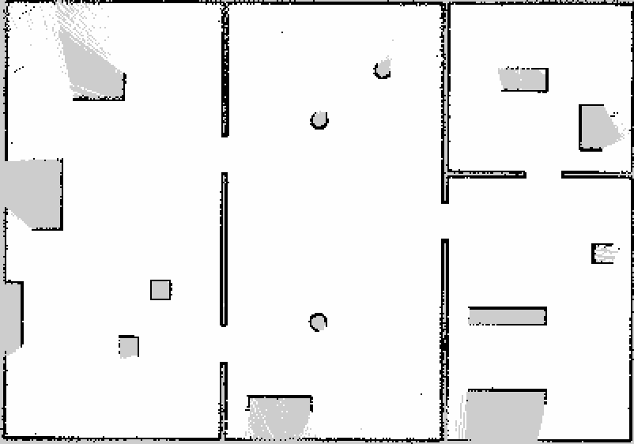

# Unitree Go2 ROS2

<p align="center">
  
</p>

## Overview

This package provides a complete ROS 2 Jazzy integration for the Unitree Go2 quadrupedal robot using the CHAMP controller framework. It includes custom configuration packages and robot description models specifically adapted for ROS 2, enabling simulation, control, and autonomous operation capabilities.

## About Unitree Go2

The Go2 is a quadrupedal robot manufactured by Unitree Robotics, designed for both research and commercial applications. It features powerful actuators, advanced sensor integration, and a robust mechanical design capable of navigating various terrains.

## About CHAMP Controller

CHAMP (Coupled Hybrid Automata for Mobile Platforms) is an open-source development framework designed for quadrupedal robots. It provides a hierarchical control system that combines pattern modulation and impedance control techniques for efficient locomotion.


## Features

- ✅ Complete ROS 2 Jazzy integration
- ✅ URDF model adapted to ROS 2 control framework
- ✅ Gazebo Harmonic simulation support
- ✅ Teleoperation using keyboard
- ✅ RVIZ visualization
- ✅ Integrated gait control and configuration
- ✅ Simulated sensors (in progress):
  - ✅ IMU
  - ✅ 2D LiDAR (Hokuyo)
  - ✅ 3D LiDAR (Velodyne)
  - ✅ 3D LiDAR (4D Lidar L1) (need some imporvments)
  - ✅ Mono Camera
  - ✅ Depth Camera (RealSense D455)
  - ✅ GPS (NavSat — simulates standard u-blox, ~0.5 m horizontal accuracy)
- ✅ Point cloud visualization in RVIZ
- ✅ Multiple sensor configurations available
- ❌ Full SLAM functionality (Coming soon)
- ❌ Navigation 2 integration (Coming soon)

## System Requirements

- Ubuntu 24.04
- ROS 2 Jazzy
- Gazebo Sim Harmonic

## Installation

### 1. Install ROS 2 Dependencies

```bash
sudo apt update
sudo apt install ros-jazzy-gazebo-ros2-control
sudo apt install ros-jazzy-xacro
sudo apt install ros-jazzy-robot-localization
sudo apt install ros-jazzy-ros2-controllers
sudo apt install ros-jazzy-ros2-control
sudo apt install ros-jazzy-velodyne
sudo apt install ros-jazzy-velodyne-description
```

### 2. Clone and Install CHAMP Controller and Go2 Simulation Packages

```bash
cd ~/ros2_ws/src
git clone https://github.com/khaledgabr77/unitree_go2_ros2
```

### 3. Install Dependencies

```bash
cd ~/ros2_ws
rosdep update
rosdep install --from-paths src --ignore-src -r -y
```

### 4. Build the Workspace

```bash
cd ~/ros2_ws
colcon build
source install/setup.bash
```

## Usage

### Gazebo Simulation

Launch the Gazebo simulation:

```bash
ros2 launch unitree_go2_sim unitree_go2_launch.py
```

Useful arguments:

| Argument | Default | Effect |
|----------|---------|--------|
| `world` | `worlds/default.sdf` | world file; `go2_indoor.sdf` and `go2_outdoor.sdf` ship next to it |
| `gui` | `true` | `false` runs Gazebo as a headless server (`-s --headless-rendering`); the lidars and cameras still render |
| `rviz` | `true` | start RViz |
| `publish_map_odom_tf` | `true` | identity `map -> odom`; set `false` when SLAM or AMCL owns that transform |
| `world_init_x/_y/_heading` | `0` | spawn pose |

ROS `/clock` comes from `gz_clock_relay.py`, not from the bridge. A bridge
whose gz subscription misses Gazebo's `/clock` advertisement never retries,
and with no ROS `/clock`, `controller_manager` and the CHAMP nodes never tick:
the robot lies on the floor while its sensors keep publishing. The relay
re-subscribes from a fresh gz-transport node whenever the clock has been silent
for 2 s. The sensor bridges start after the robot has been spawned. See
`docs/architecture.md`.

To check a running simulation (topic rates, real-time factor, and the
ground-truth distance walked for a `/cmd_vel` command):

```bash
python3 tools/go2_sim_check.py --json /tmp/go2_check.json
```

Measured on this setup (Jazzy, Gazebo Harmonic 8.15, RTX 5090, headless, 3 cold
launches): RTF 0.98 to 1.00, `/clock` about 1 kHz, IMU 93 to 99 Hz, GPS and
Velodyne 9.3 to 9.9 Hz (7040 points per scan), 2.85 to 3.06 m walked for
0.3 m/s for 10 s.

### Worlds

`unitree_go2_description/worlds/` holds `default.sdf` (flat) and two test
worlds generated by `generate_worlds.py` from primitive shapes only, so they
load offline:

- `go2_indoor.sdf`: a 20 × 14 m floor with a hall, a west room and two east
  rooms joined by 1.2 m doorways, plus tables, shelves, racks and pillars;
- `go2_outdoor.sdf`: a 60 × 60 m yard with a building, parked cars, trees,
  rocks, a fence and a 6° ramp, geo-referenced for the GPS.

Both use the physics (bullet-featherstone, 1 ms) and system plugins of
`default.sdf`. Edit `generate_worlds.py` and re-run it rather than editing the
`.sdf` files.

### SLAM and navigation

`unitree_go2_navigation` adds the 2D navigation stack:

```bash
# Go2 in the indoor world + slam_toolbox + Nav2, headless
ros2 launch unitree_go2_navigation go2_nav_sim.launch.py world:=indoor
# the same on a saved map with AMCL instead of SLAM
ros2 launch unitree_go2_navigation go2_nav_sim.launch.py \
    map:=$(ros2 pkg prefix unitree_go2_navigation)/share/unitree_go2_navigation/maps/go2_indoor.yaml
# send goals (map frame) and measure them against Gazebo ground truth
ros2 run unitree_go2_navigation go2_nav_check.py --goals "-2.0,2.1 -4.6,2.1"
```

The pipeline runs Velodyne `PointCloud2`, then `pointcloud_to_laserscan` with a
0.12 to 1.2 m height window above `base_footprint`, then a `laser_filters` box
self-filter around the body, giving `/scan`. That scan feeds `slam_toolbox`
(online async, 5 cm) or `map_server` plus AMCL, then Nav2: NavFn planner, MPPI
controller (DiffDrive, 0.4 m/s, 0.8 rad/s), velocity smoother and collision
monitor. Nav2 publishes a plain `geometry_msgs/Twist` on `/cmd_vel`, which is
what CHAMP reads. The parameters are in `unitree_go2_navigation/config/`;
`nav2_params.yaml` and `slam_toolbox.yaml` are generated from the stock Jazzy
files by `scripts/generate_params.py`. Save a map with
`ros2 run nav2_map_server map_saver_cli -f <name> --ros-args -p use_sim_time:=true`.

Measured in `go2_indoor.sdf` (headless, 2026-10-30; ground-truth error is the
distance between the goal and where Gazebo says the robot stopped):

| Run | Goals | Reached | Ground-truth error |
|-----|-------|---------|--------------------|
| SLAM, waypoint mapping route through every room | 13 | 12 (the 13th, the long way home, ran out its 120 s) | 0.09 to 0.37 m |
| AMCL on the saved map, cross-building goals | 4 | 3 (the north-east room, two doorways deep, timed out at 240 s) | 0.18 to 0.29 m |
| SLAM, goals into rooms not yet seen | 2 | 0 (NavFn through unknown space; use waypoints or a saved map) | n/a |




#### Joint command interface

The joints are driven through `ros2_control`. By default the effort
interface is used, matching `joint_group_effort_controller` in
`unitree_go2_sim/config/ros_control/ros_control.yaml`. If needed,
can be changed to position interface with:

```bash
ros2 launch unitree_go2_sim unitree_go2_launch.py command_interface:=position
```

Remember to switch the spawned controller in `ros_control.yaml` to a
position controller as well, otherwise the controller manager will fail to
claim the joints.

#### Leaving sensors out

All sensors are mounted by default. Each one can be left out of the robot
description, which is useful when running headless or on a machine that
struggles with the point cloud sensors:

| Argument | Sensor |
|----------|--------|
| `disable_camera` | mono RGB camera |
| `disable_d455` | RealSense D455 RGBD camera (defaults to `true` when `realsense2_description` is not installed) |
| `disable_lidar_l1` | 4D Lidar L1 |
| `disable_velodyne_lidar` | Velodyne VLP-16 |

```bash
ros2 launch unitree_go2_sim unitree_go2_launch.py \
    disable_velodyne_lidar:=true disable_d455:=true
```

[Watch Demo on YouTube](https://youtu.be/NUu7TaZhaQM)

### RVIZ Visualization

The package now includes both `Velodyne 3D LiDAR` and `4D Lidar L1` sensors. You can visualize the point cloud data in RVIZ:

Launch Gazebo with RVIZ:

```bash
ros2 launch unitree_go2_sim unitree_go2_launch.py rviz:=true
```


**Velodyne Lidar and 4D Lidar L1**


**Velodyne Lidar Beams**


**4D Lidar L1 Beams**


**Velodyne Lidar and 4D Lidar L1 Beams**


**Mono Camera**


### Teleoperation

Control the robot using keyboard:

```bash
ros2 run teleop_twist_keyboard teleop_twist_keyboard
```

### GPS Simulation

The robot includes a simulated GPS (NavSat) sensor mounted on top of the trunk, publishing at 10 Hz on `/gps/fix` as `sensor_msgs/msg/NavSatFix`.

The sensor models standard u-blox-level accuracy:

| Axis | Noise (std dev) | Equivalent variance |
|------|----------------|---------------------|
| Horizontal (lat/lon) | 0.5 m | 0.25 m² |
| Vertical (altitude) | 0.8 m | 0.64 m² |

**Verify it is working:**

```bash
ros2 topic echo /gps/fix
```

**Setting the geographic origin:**

The world's GPS origin is defined in `unitree_go2_description/worlds/default.sdf` under `<spherical_coordinates>`. Edit `latitude_deg`, `longitude_deg`, and `elevation` to match your actual test site before running navigation experiments:

```xml
<spherical_coordinates>
  <surface_model>EARTH_WGS84</surface_model>
  <world_frame_orientation>ENU</world_frame_orientation>
  <latitude_deg>YOUR_LAT</latitude_deg>
  <longitude_deg>YOUR_LON</longitude_deg>
  <elevation>YOUR_ALT_METERS</elevation>
  <heading_deg>0</heading_deg>
</spherical_coordinates>
```

> **Note:** The `position_covariance` field in the bridged message will be all-zeros (`COVARIANCE_TYPE_UNKNOWN`) because the Gazebo→ROS bridge does not carry covariance. When integrating with `robot_localization`, set the covariance override in your EKF config or add a relay node that stamps diagonal covariance values matching the noise above.

## Tuning Gait Parameters

The gait configuration for the robot is found in `unitree_go2_sim/config/gait/gait.yaml`. You can modify the following parameters:

| Parameter | Description |
|-----------|-------------|
| Knee Orientation | How the knees should be bent (.>> .>< .<< .<>) |
| Max Linear Velocity X | Maximum forward/reverse speed (m/s) |
| Max Linear Velocity Y | Maximum sideways speed (m/s) |
| Max Angular Velocity Z | Maximum rotational speed (rad/s) |
| Stance Duration | How long each leg spends on the ground while walking |
| Leg Swing Height | Trajectory height during swing phase (m) |
| Leg Stance Height | Trajectory depth during stance phase (m) |
| Robot Walking Height | Distance from hip to ground while walking (m) |
| CoM X Translation | Offset to compensate for weight distribution |
| Odometry Scaler | Multiplier to calculated velocities for dead reckoning |


## Project Structure

- `champ/`: Core controllers and state estimation for CHAMP
- `unitree_go2_description/`: URDF models, meshes, and world files
- `unitree_go2_sim/`: Simulation launch files and configuration
- `unitree_go2_navigation/`: scan pipeline, self-filter, SLAM, AMCL and Nav2 launch/config, saved maps
- `unitree_application/`: Gazebo foot-contact to `champ_msgs` bridge
- `tools/go2_sim_check.py`: measures a running simulation

## Contributing

Contributions are welcome! Please feel free to submit a Pull Request.

1. Fork the repository
2. Create your feature branch (`git checkout -b feature/AmazingFeature`)
3. Commit your changes (`git commit -m 'feat: Add some AmazingFeature'`)
4. Push to the branch (`git push origin feature/AmazingFeature`)
5. Open a Pull Request

## Acknowledgements

This project builds upon and incorporates work from the following projects:

* [Unitree Robotics](https://github.com/unitreerobotics/unitree_ros) - For the Go2 robot description (URDF model)
* [CHAMP](https://github.com/chvmp/champ) - For the quadruped controller framework
* [CHAMP Robots](https://github.com/chvmp/robots) - For robot configurations and setup examples
* [unitree-go2-ros2](https://github.com/anujjain-dev/unitree-go2-ros2) - ROS 2 package with gazebo classic

## License
